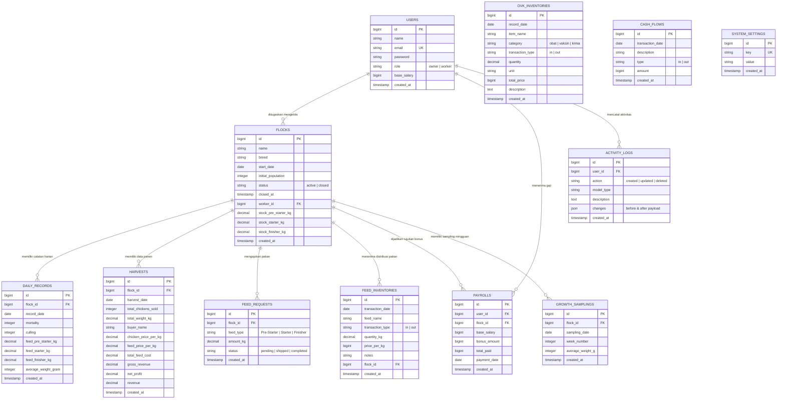

# PRODUCT REQUIREMENT DOCUMENT (PRD)
# BROILERAPP PRO — SMART POULTRY FARM MANAGEMENT SYSTEM

---

## 1. INFORMASI DOKUMEN & RINGKASAN EKSEKUTIF

### 1.1. Informasi Dokumen
- **Nama Produk**: BroilerApp Pro (SmartCoop Farm Management System)
- **Versi Dokumen**: 1.0.0 (Production-Ready Technical Specification)
- **Status Dokumen**: Disetujui / Baseline Dokumen Resmi
- **Target Pembaca**: Technical Leads, Software Engineers, Product Managers, Farm Operations Directors, dan Tim Auditor Peternakan.

### 1.2. Ringkasan Eksekutif (Executive Summary)
**BroilerApp Pro** adalah aplikasi web komprehensif untuk tata kelola operasional, rantai pasok (supply chain), dan audit finansial peternakan ayam broiler modern. Sistem ini dirancang untuk mengatasi masalah utama dalam industri perunggasan (poultry farming):
1. **Kebocoran Pakan & Kecurangan Lapangan (Feed Shrinkage & Fraud)**: Menggunakan validasi batas kapasitas lambung biologis ayam (*biological stomach capacity threshold*) dan sistem rantai pasok pakan 3 tingkat (*3-step logistics*).
2. **Keterlambatan Deteksi Risiko Kematian (High Mortality Delay)**: Menggunakan Sistem Peringatan Dini (*Early Warning System / EWS*) untuk deplesi harian melebihi 0.5% dari populasi awal.
3. **Buta Finansial Berjalan (Lack of Real-time P&L Visibility)**: Dilengkapi dengan algoritma peramalan laba-rugi harian (*real-time P&L forecasting*) dan *Live BEP Target Tracker Chart* yang memetakan bobot ayam terhadap titik impas biaya harian (*Break-Even Point*).
4. **Perhitungan Evaluasi Peternakan Standar Industri**: Menghitung secara otomatis *Feed Conversion Ratio* (FCR), *Livability* (Daya Hidup), dan *Indeks Performansi* (IP / *European Production Efficiency Factor*).
5. **Penggajian Berbasis Kinerja (IP-Driven Payroll)**: Menghubungkan performa hasil panen (IP > 300) dengan insentif bonus pekerja kandang secara objektif dan otomatis.

---

## 2. USER PERSONA & ROLE-BASED ACCESS CONTROL (RBAC)

Aplikasi menerapkan kontrol akses berbasis peran (*Role-Based Access Control / RBAC*) yang ketat menggunakan Laravel Gate dan Policy.

### 2.1. Definisi User Persona

#### Persona 1: Owner (Pemilik Peternakan / Investor)
- **Tanggung Jawab**:
  - Mengawasi keseluruhan kandang, gudang, staf, dan finansial.
  - Menentukan harga pasar global broiler, harga kontrak bibit (DOC), dan harga pakan.
  - Membuka siklus kandang baru dan mengeksekusi panen (baik manual maupun otomatis 1-klik).
  - Mengelola pengadaan pakan pusat dan menyetujui distribusi pakan ke gudang kandang.
  - Menerbitkan penggajian (*payroll*) dan meninjau seluruh laporan laba-rugi serta audit trail aktivitas.
- **Karakteristik Akses**: Superadmin (`role = 'owner'`). Memiliki akses penuh ke seluruh rute, termasuk rute enterprise yang diproteksi `Gate::authorize('manage-enterprise')`.

#### Persona 2: Worker (Anak Kandang / Operator Lapangan)
- **Tanggung Jawab**:
  - Merawat ayam di kandang yang ditugaskan (*assigned flock*).
  - Melakukan input catatan harian (*daily records*): kematian, afkir, konsumsi pakan 3 fase, dan rata-rata bobot sampling.
  - Mengajukan permintaan pakan (*feed request*) ke gudang utama saat stok kandang menipis.
  - Mengonfirmasi penerimaan pakan (*receive shipment*) ketika pakan fisik tiba di kandang.
- **Karakteristik Akses**: Terbatas (`role = 'worker'`). Hanya dapat melihat dan mengelola kandang dengan `worker_id` miliknya sendiri. Tidak dapat melihat data finansial rahasia (laba bersih, cash flow, analitik agregat, penggajian, dan log audit).

### 2.2. Matriks Otorisasi CRUD (Permission Matrix)

| Modul & Fungsionalitas | Owner | Worker (Assigned Flock) | Worker (Unassigned Flock) | Guest (Unauthenticated) |
| :--- | :---: | :---: | :---: | :---: |
| **Lihat Daftar Kandang (Index)** | Semua Kandang | Hanya Kandang Ditugaskan | Ditolak (Kosong) | Redirect ke Login |
| **Tambah / Hapus Kandang** | Ya (Penuh) | Tidak (403) | Tidak (403) | Redirect ke Login |
| **Input / Edit / Hapus Catatan Harian** | Ya | Ya | Tidak (403) | Redirect ke Login |
| **Kalkulator Sampling Bobot** | Ya | Ya | Tidak (403) | Redirect ke Login |
| **Ajukan Permintaan Pakan** | Ya | Ya | Tidak (403) | Redirect ke Login |
| **Setujui & Kirim Pakan (Ship)** | Ya | Tidak (403) | Tidak (403) | Redirect ke Login |
| **Konfirmasi Penerimaan Pakan** | Ya | Ya | Tidak (403) | Redirect ke Login |
| **Eksekusi Panen (Manual / 1-Klik)** | Ya | Tidak (403) | Tidak (403) | Redirect ke Login |
| **Lihat Proyeksi Laba/Rugi Realtime**| Ya | Ya | Tidak (403) | Redirect ke Login |
| **Gudang Pakan Pusat (Mutasi & Edit)**| Ya | Tidak (403) | Tidak (403) | Redirect ke Login |
| **Enterprise Analitik & Benchmarking**| Ya | Tidak (403) | Tidak (403) | Redirect ke Login |
| **Riwayat Finansial Global** | Ya | Tidak (403) | Tidak (403) | Redirect ke Login |
| **Manajemen Penggajian (Payroll)** | Ya | Tidak (403) | Tidak (403) | Redirect ke Login |
| **Manajemen OVK (Obat/Vaksin/Kimia)** | Ya | Tidak (403) | Tidak (403) | Redirect ke Login |
| **Arus Kas Operasional (Cash Flow)** | Ya | Tidak (403) | Tidak (403) | Redirect ke Login |
| **Manajemen Pegawai (HRD)** | Ya | Tidak (403) | Tidak (403) | Redirect ke Login |
| **Log Aktivitas & Audit Trail** | Ya | Tidak (403) | Tidak (403) | Redirect ke Login |
| **Cetak PDF Laporan Panen & P&L** | Ya | Tidak (403) | Tidak (403) | Redirect ke Login |
| **Cetak Buku Recording Harian** | Ya | Ya | Tidak (403) | Redirect ke Login |
| **Ekspor CSV (Excel BOM)** | Ya | Ya | Tidak (403) | Redirect ke Login |
| **Ubah Harga Pasar Global** | Ya | Tidak (403) | Tidak (403) | Redirect ke Login |

---

## 3. ARSITEKTUR TEKNOLOGI & INFRASTRUKTUR SISTEM

```
+---------------------------------------------------------------------------------+
|                                 CLIENT TIER                                     |
|  - Modern Web Browsers (Chrome, Firefox, Safari, Edge, Mobile Responsive)       |
|  - Alpine.js (State Machine, Reactive UI, Modal & Slide-Over Drawers)           |
|  - Tailwind CSS 3/4 (Design Tokens, Dark/Light Mode Anti-Flashbang System)       |
|  - Chart.js (Real-time Line, Bar, and Heatmap Canvas Visualizations)            |
+---------------------------------------------------------------------------------+
                                      | HTTP(S) / AJAX JSON
                                      v
+---------------------------------------------------------------------------------+
|                               APPLICATION TIER                                  |
|  - PHP 8.3+ / Laravel 11/13 Web Framework Engine                                |
|  - Routing & Middleware Layer (Auth, Verified, Manage-Enterprise Gate)          |
|  - Controllers Layer (Resourceful, AJAX endpoints, PDF streaming)               |
|  - Domain Policy & Gate Security (FlockPolicy, Role Check)                      |
|  - Eloquent ORM & Observability Traits (LogsActivity Lifecycle Hooks)           |
|  - Document Generators (Barryvdh DomPDF & Streamed CSV UTF-8 Exporters)         |
+---------------------------------------------------------------------------------+
                                      | SQL Queries & Transactions
                                      v
+---------------------------------------------------------------------------------+
|                                  DATA TIER                                      |
|  - Relational Database: MySQL 8.0+ / SQLite 3                                    |
|  - Tables: users, flocks, daily_records, harvests, feed_inventories,             |
|            feed_requests, ovk_inventories, cash_flows, payrolls, activity_logs  |
+---------------------------------------------------------------------------------+
```

### 3.1. Spesifikasi Perangkat Lunak (Software Stack)
1. **Bahasa Pemrograman**: PHP v8.3 atau lebih baru.
2. **Framework Backend**: Laravel Framework (v11.x / v12.x / v13.x compatible).
3. **Autentikasi**: Laravel Breeze (Blade stack dengan Session Guard terenkripsi).
4. **Engine Frontend**:
   - **Blade Templating Engine**: Templat view modular dengan layout terpusat (`x-app-layout`, `layouts/print.blade.php`).
   - **Tailwind CSS**: Utility-first CSS dengan plugin `@tailwindcss/forms` dan `@tailwindcss/vite`.
   - **Alpine.js (v3.x)**: Reaktivitas frontend ringan untuk kontrol slide-over drawer, modal form, submit AJAX, kalkulator bobot, dan dynamic DOM updating.
   - **Chart.js (v4.x)**: Visualisasi grafik performa mortalitas, konsumsi pakan, grafik proyeksi BEP, dan heatmap IP.
5. **Mesin Pelaporan (Reporting Engine)**:
   - `barryvdh/laravel-dompdf` (v3.1): Render server-side PDF.
   - Clean Print Layout (CSS `@media print` murni) untuk pencetakan langsung melalui dialog browser dengan margin dan page-break standar A4.
   - Streamed Response dengan UTF-8 Byte Order Mark (`\xEF\xBB\xBF`) untuk ekspor CSV agar langsung terbaca rapi di Microsoft Excel.
6. **Tooling & Bundler**: Vite 8, PostCSS, Autoprefixer, Laravel Vite Plugin.

### 3.2. Fitur UX & Desain Antarmuka (Interface & Eye-Care Features)
- **Anti-Flashbang (Eye-Care) Light Mode**: Menghindari latar belakang putih kontras murni `#ffffff` yang menyilaukan mata peternak di kandang, menggunakan warna redup lembut `slate-100` (`#f1f5f9`) dan kartu `slate-50` (`#f8fafc`).
- **Dark Mode FOIT (Flash of Incoherent Theme) Prevention**: Inline script pada `<head>` yang memeriksa `localStorage.theme` atau preferensi OS (`prefers-color-scheme`) sebelum render DOM dimulai, menghindari layar berkedip putih saat reload di malam hari.
- **Responsive Mobile Navigation**: Sidebar desktop yang elegan dan mobile slide-out drawer yang ramah sentuhan untuk petugas di lapangan.
- **Skeleton Loader**: Animasi placeholder abu-abu saat grafik Chart.js sedang mengalkulasi data.

---

## 4. SPESIFIKASI FUNGSIONAL & ALUR KERJA (DETAILED MODULES)

### 4.1. Modul Manajemen Siklus Kandang (Flock Management)

#### A. Deskripsi & Fungsionalitas
Kandang adalah unit produksi utama dalam peternakan broiler. Siklus kandang berjalan sejak bibit Day-Old-Chick (DOC) dimasukkan (*chick-in*) hingga ayam dipanen habis (*closed/panen*).
- **Pembuatan Kandang**: Owner membuat kandang dengan nama, ras/breed (misal: *Cobb 500*, *Ross 308*, *Hubbard*), tanggal mulai (*start_date*), jumlah populasi awal (*initial_population*), dan menugaskan seorang worker.
- **Indikator Progres Umur Siklus**: Progres umur dihitung otomatis berdasarkan rumus:
  $$\text{Umur (Hari)} = \max\left(1, \text{diffInDays}(\text{start\_date}, \text{closed\_at} \lor \text{now()})\right)$$
  Terdapat visual bar kemajuan menuju umur target standar panen ayam broiler (35 hari):
  $$\text{Progress (\%)} = \min\left(100, \frac{\text{Umur}}{35} \times 100\right)$$
- **Status Kandang**:
  - `active`: Kandang sedang dalam masa pemeliharaan aktif. Form catatan harian, permintaan pakan, dan panen aktif.
  - `closed`: Kandang telah selesai dipanen. Data dikunci (*locked*) dan hanya dapat dilihat sebagai riwayat historis retrospeksi.

---

### 4.2. Modul Pencatatan Harian (Daily Records) & Early Warning System (EWS)

#### A. Komponen Input
Setiap hari, pekerja kandang mencatat:
1. Tanggal pencatatan (`record_date`).
2. Jumlah kematian ayam alami (`mortality`).
3. Jumlah ayam afkir/sakit dikeluarkan (`culling`).
4. Konsumsi pakan per fase:
   - Pakan Fase Pre-Starter (Kg) — biasanya umur 1-7 hari.
   - Pakan Fase Starter (Kg) — biasanya umur 8-21 hari.
   - Pakan Fase Finisher (Kg) — biasanya umur 22 hari ke atas.
5. Bobot rata-rata ayam dalam satuan gram per ekor (`average_weight_gram`).

#### B. Fitur Unggulan 1: Fraud Prevention & Kapasitas Lambung Biologis (EWS Pakan)
Untuk mencegah penggelapan pakan (anak kandang menginput konsumsi pakan fiktif padahal pakan dijual ke pihak luar), sistem memberlakukan validasi kapasitas biologis ayam broiler:
1. Hitung umur ayam pada tanggal record:
   $$\text{AgeInDays} = \max\left(1, \text{diffInDays}(\text{start\_date}, \text{record\_date}) + 1\right)$$
2. Hitung batas toleransi konsumsi maksimum per ekor per hari berdasarkan literatur zooteknik unggas:
   $$\text{MaxGramPerBird} = \min\left(300, (\text{AgeInDays} \times 7) + 30\right)$$
3. Hitung populasi hidup aktual pada tanggal tersebut:
   $$\text{LivePopulation} = \max\left(1, \text{initial\_population} - \sum \text{mortality} - \sum \text{culling}\right)$$
4. Hitung batas atas pakan yang diizinkan masuk sistem:
   $$\text{MaxFeedKgAllowed} = \frac{\text{LivePopulation} \times \text{MaxGramPerBird}}{1000}$$
5. **Aturan Validasi**: Jika $\sum \text{InputPakanKg} > \text{MaxFeedKgAllowed}$, sistem menolak input secara keras (*HTTP 422 Unprocessable Entity*) dengan pesan:
   > *"Peringatan Anomali! Berdasarkan umur (X hari) dan populasi hidup (Y ekor), kapasitas lambung maksimum ayam hanya Z Kg/hari. Input pakan Anda menembus batas biologis (Indikasi Kecurangan)."*

#### C. Fitur Unggulan 2: Peringatan Dini Kematian Tinggi (EWS Mortality Warning)
- Sistem menghitung persentase kematian harian terhadap populasi awal:
  $$\text{MortalityRate} = \frac{\text{mortality}}{\text{initial\_population}}$$
- Jika $\text{MortalityRate} > 0.005$ (> 0.5% populasi mati dalam satu hari):
  - Baris tabel diwarnai merah muda (`bg-red-50 border-l-4 border-red-500`).
  - Badge peringatan otomatis disematkan: `⚠️ High Mortality (>0.5%)`.
  - Memberikan sinyal waspada dini adanya wabah penyakit ganas (ND, AI, Gumboro) atau kegagalan sistem ventilasi/suhu kandang.

#### D. Fitur Unggulan 3: Auto-Deduct & Revert Stock Pakan Kandang
- Setiap kali catatan harian disimpan, stok pakan di kandang bersangkutan (`stock_pre_starter_kg`, `stock_starter_kg`, `stock_finisher_kg`) secara otomatis berkurang sesuai fase pakan yang dipilih.
- Transaksi otomatis dibuat di mutasi gudang (`feed_inventories`) dengan tipe `out` dan label `(Auto)`.
- **Logika Edit**: Jika data diubah, sistem menghitung selisih (`diff = new - old`) dan menyesuaikan sisa stok.
- **Logika Hapus**: Jika catatan harian dihapus, seluruh kuantitas pakan yang sebelumnya dipakai dikembalikan (*increment*) ke gudang kandang.

#### E. Fitur Unggulan 4: Slide-Over Ajax Panel & Kalkulator Sampling Acak
- Form input dibuka dalam panel geser (*slide-over drawer*) modern tanpa reload halaman.
- **Kalkulator Sampling Acak (Metode Standar 3 Karung x 10 Ekor = 30 Ekor)**:
  - Petugas menimbang 3 karung berisi masing-masing 10 ekor ayam acak dari sekat berbeda di kandang.
  - Memasukkan berat Karung 1 (Kg), Karung 2 (Kg), Karung 3 (Kg).
  - Sistem menghitung:
    $$\text{Rata-rata Gram/Ekor} = \frac{\text{Karung}_1 + \text{Karung}_2 + \text{Karung}_3}{30} \times 1000$$
  - Tombol **"Gunakan Hasil Ini"** langsung menyalin nilai gram ke input bobot utama secara instan.
- Setelah submit sukses via AJAX:
  - Tabel catatan harian diperbarui seketika.
  - Grafik mortalitas, konsumsi pakan, dan grafik BEP diperbarui tanpa *page reload*.
  - Sisa stok pakan di kartu indikator langsung berkurang secara *real-time*.

---

### 4.3. Modul Rantai Pasok Pakan (3-Step Feed Logistics)

Untuk mencegah kehilangan pakan antara Gudang Pusat (*Central Warehouse*) dan Gudang Kandang (*Flock Shed Storage*), diterapkan mekanisme rantai pasok 3 tahap:

```
[ Anak Kandang ]                   [ Pemilik / Owner ]                [ Anak Kandang ]
       |                                   |                                  |
 1. REQUEST FEED                           |                                  |
    - Pilih Jenis (Pre/Start/Finish)       |                                  |
    - Masukkan Jumlah (Kg)                 |                                  |
    - Status: PENDING                      |                                  |
       |---------------------------------->|                                  |
                                           |                                  |
                                     2. APPROVE & SHIP                        |
                                        - Potong Stok Gudang Pusat            |
                                        - Buat Mutasi OUT (Gudang)            |
                                        - Status: SHIPPED                     |
                                           |--------------------------------->|
                                                                              |
                                                                        3. CONFIRM RECEIVE
                                                                           - Tambah Stok Kandang
                                                                           - Status: COMPLETED
```

1. **Permintaan Pakan (Request)**:
   - Worker membuat permohonan pakan spesifik (`Pre-Starter`, `Starter`, atau `Finisher`) beserta jumlah kilogramnya. Status: `pending`.
2. **Persetujuan & Pengiriman (Ship)**:
   - Hanya Owner yang dapat menyetujui pengiriman.
   - Saat Owner menekan *Setujui & Kirim*, sistem mencatat pengeluaran pakan dari Gudang Pusat (`feed_inventories` tipe `out`), dan mengubah status menjadi `shipped`.
3. **Penerimaan Fisik (Receive)**:
   - Ketika truk pengantar pakan sampai di kandang, Worker menekan tombol *Terima Pakan*.
   - Status berubah menjadi `completed`, dan kuantitas pakan bertambah ke kolom stok spesifik kandang (`stock_pre_starter_kg`, `stock_starter_kg`, atau `stock_finisher_kg`).
4. **Peringatan Stok Kritis Gudang Pusat**:
   - Jika total stok pakan di gudang pusat $< 500\text{ Kg}$, kartu KPI gudang memunculkan peringatan merah berkedip: `⚠️ PERINGATAN: Stok pakan kritis (< 500 kg)! Segera lakukan restok.`
5. **Inline Editing Mutasi Pakan**:
   - Tabel mutasi gudang mendukung *Inline Editing* via AJAX pada kolom kuantitas dan catatan tanpa reload halaman.

---

### 4.4. Modul Pemanenan & Otomatisasi Finansial (Harvest & Financial Settlement)

#### A. Mode Pemanenan
1. **Panen Manual**:
   - Input tanggal panen, total tonase timbangan (Kg), harga jual ayam per Kg, harga pakan per Kg, dan nama pembeli/RPA.
   - Sistem menghitung populasi ayam terjual dari selisih deplesi:
     $$\text{ChickensSold} = \max\left(0, \text{initial\_population} - \sum \text{mortality} - \sum \text{culling}\right)$$
2. **Panen Otomatis 1-Klik (1-Click Auto-Harvest)**:
   - Dirancang untuk pemilik yang ingin menutup siklus kandang seketika berdasarkan estimasi data harian terakhir.
   - Sistem mengambil bobot ayam rata-rata dari record harian paling akhir (atau fallback 1.600 gram).
   - Menghitung total tonase proyeksi, mengambil harga pasar global (`global_market_price`), harga pakan (`feed_price`), dan harga bibit (`doc_price`) dari database pengaturan sistem.
   - Otomatis mencatat transaksi panen dan mengubah status kandang menjadi `closed`.

#### B. Fitur Unggulan 1: Real-Time P&L Forecasting Widget (Estimasi Laba Berjalan)
Pada kandang aktif, terdapat panel proyeksi finansial *real-time*:
- **Total Biaya Berjalan**:
  $$\text{TotalCost} = (\text{initial\_population} \times \text{doc\_price}) + (\text{totalFeedConsumed} \times \text{feed\_price})$$
- **Potensi Pendapatan Berjalan**:
  $$\text{EstimatedRevenue} = \text{LivePopulation} \times \left(\frac{\text{LatestAvgWeightGram}}{1000}\right) \times \text{global\_market\_price}$$
- **Proyeksi Laba Bersih**:
  $$\text{NetProfit} = \text{EstimatedRevenue} - \text{TotalCost}$$

#### C. Fitur Unggulan 2: Live BEP Growth Tracker Chart
Grafik Chart.js dinamis yang membandingkan dua kurva per hari:
1. **Kurva Biru (Aktual Bobot Ayam / Ekor)**: Bobot nyata hasil penimbangan harian.
2. **Kurva Merah Putus-putus (Target Minimal BEP Gram / Ekor)**:
   $$\text{BEPTargetGramPerBird} = \left(\frac{\frac{\text{CumulativeCost}}{\text{global\_market\_price}}}{\text{CurrentPopulation}}\right) \times 1000$$
- **Interpretasi Visual**: Jika garis biru berada di atas garis merah, peternakan dalam posisi **POTENSI PROFIT** pada hari tersebut. Jika di bawah, peternakan masih merugi (*Break-Even Point* belum terlampaui).

---

### 4.5. Modul Analitik & Benchmarking (Enterprise Analytics)

Khusus dapat diakses oleh Owner untuk membandingkan kinerja lintas siklus kandang yang telah ditutup (*closed*):
1. **Rata-Rata Agregat Peternakan**:
   - Rata-rata IP (*Farm Average IP*).
   - Rata-rata FCR (*Farm Average FCR*).
   - Rata-rata Daya Hidup (*Farm Average Livability*).
2. **IP Benchmarking Heatmap Chart**:
   - Grafik batang interaktif yang mengklasifikasikan performa tiap kandang dengan warna standar industri:
     - 🟢 **Hijau (IP > 300)**: *Excellent* (Sangat Bagus / Target Standar Modern).
     - 🟡 **Kuning (IP 250 - 300)**: *Good* (Baik / Masih Menguntungkan).
     - 🔴 **Merah (IP < 250)**: *Needs Focus* (Kurang / Perlu Evaluasi Biosekuriti & Nutrisi).
3. **Tabel Komparasi Lintas Siklus**: Memetakan korelasi antara ras ayam, nama worker pengelola, lama umur panen, FCR, dan IP.

---

### 4.6. Modul Penggajian Pekerja (Payroll System)

Menghubungkan produktivitas teknis peternakan dengan kesejahteraan anak kandang:
1. **Struktur Gaji**:
   $$\text{Total Gaji} = \text{Base Salary (Gaji Pokok)} + \text{Bonus Performa}$$
2. **Logika Bonus Otomatis Berbasis IP**:
   - Ketika Owner memilih seorang pekerja dan kandang tertutup yang baru selesai dipanen, sistem secara otomatis menghitung nilai IP kandang tersebut.
   - **Aturan**: Jika nilai $\text{IP} > 300$, sistem secara otomatis menambahkan **Bonus Performa sebesar Rp 500.000**. Jika $\text{IP} \le 300$, bonus bernilai Rp 0.
3. **Cetak Slip Gaji Resmi**:
   - Dilengkapi nomor referensi unik `PAY-XXXXX`.
   - Menampilkan rincian identitas pekerja, kandang binaan, gaji pokok, status pencapaian IP, nominal bonus, dan total uang diterima.

---

### 4.7. Modul Inventaris OVK (Obat, Vaksin, Kimia)

Mengelola stok dan pengeluaran medikasi peternakan:
- **Kategori**: `obat` (antibiotik, vitamin, antistres), `vaksin` (ND-IB, Gumboro, AI), dan `kimia` (disinfektan kandang, kapur, kaporit).
- **Jenis Transaksi**:
  - `in`: Pengadaan barang baru dengan kuantitas, satuan (vial, botol, liter, kg), dan total harga belanja.
  - `out`: Pemakaian barang untuk aplikasi ke ayam atau sterilisasi kandang. Total harga otomatis diset kosong (*null*).
- **Statistik**: Total pengeluaran akumulatif belanja OVK peternakan.

---

### 4.8. Modul Arus Kas Operasional (Cash Flow)

Mencatat keluar masuk keuangan di luar transaksi panen ayam:
- **Tipe Transaksi**: `in` (pemasukan lain-lain, misal: penjualan kotoran ayam/pupuk, karung bekas, suntikan modal) dan `out` (pengeluaran listrik, token air, gas pemanas/brooder, sekam/litter, transport).
- **Indikator Finansial**: Total Pemasukan, Total Pengeluaran, dan Saldo Kas Riil (*Balance*).
- **Pratinjau Cetak**: Laporan Arus Kas format dokumen keuangan resmi.

---

### 4.9. Modul Audit Trail & Log Aktivitas (Activity Logging)

Aplikasi memiliki sistem pengawasan internal berbasis Trait `LogsActivity`:
- Mengamati secara otomatis setiap kali model Eloquent mengalami event:
  - `created`: Mencatat waktu, aktor (`user_id`), dan model yang dibuat.
  - `updated`: Menyimpan perubahan *delta* data dalam format JSON (`before` vs `after`) secara otomatis sehingga pemilik tahu kolom apa yang diubah dan nilai lamanya.
  - `deleted`: Mencatat data apa yang dihapus.
- **Tampilan Log**: Halaman khusus Owner dengan fitur pencarian real-time (AJAX) berdasarkan nama user, model, aksi, atau keterangan.

---

### 4.10. Modul Pengaturan Sistem (System Settings)

Menyimpan konfigurasi parameter biaya standar peternakan dalam format key-value:
- `global_market_price`: Acuan harga pasar ayam broiler hidup per Kg (default: Rp 23.000). Dapat diperbarui cepat dari widget di halaman dashboard.
- `doc_price`: Biaya modal per ekor bibit DOC (default: Rp 8.000).
- `feed_price`: Biaya rata-rata pakan per Kg (default: Rp 9.000).

---

### 4.11. Modul Pelaporan & Ekspor Dokumen

Aplikasi menyediakan 6 format laporan siap pakai:
1. **Laporan Akhir Panen & Audit Finansial (P&L Document)**:
   - Menghitung **COGS** (DOC + Pakan), **OPEX** (Gaji & Bonus Payroll), dan **True Net Profit** ($\text{Revenue} - \text{COGS} - \text{OPEX}$).
   - Menghitung **BEP per Kg** ($\text{Total Pengeluaran} / \text{Total Berat Panen}$) dan **Net Profit Margin (%)**.
2. **Buku Recording Harian (Daily Records Sheet)**:
   - Rekap tabel harian berisi umur ayam, mortalitas, afkir, rincian 3 fase pakan, total pakan, dan populasi sisa untuk arsip fisik kandang.
3. **Laporan Audit Mutasi Gudang Pakan**:
   - Audit keluar masuk pakan, nilai aset pakan terpakai, dan sisa stok fisik.
4. **Laporan Arus Kas Operasional**:
   - Laporan transaksi kas masuk, kas keluar, dan saldo kas bersih.
5. **Slip Gaji Pekerja (Payslip)**:
   - Bukti tanda terima gaji dan bonus berbasis capaian IP.
6. **Ekspor Data CSV Mentah (Excel-Ready)**:
   - Mengalirkan (*streaming*) data CSV dengan header metadata lengkap dan tabel catatan harian.

---

## 5. RUMUS DAN METODE PERHITUNGAN ZOOTEKNIK & FINANSIAL

Berikut adalah ringkasan matematis seluruh formula yang diterapkan pada *source code*:

| Nama Parameter | Rumus Matematis | Satuan | Interpretasi & Standar Industri |
| :--- | :--- | :---: | :--- |
| **Populasi Hidup Aktual** | $\text{Pop} = \text{Pop}_{\text{awal}} - \sum \text{Mati} - \sum \text{Afkir}$ | Ekor | Jumlah ayam yang masih bernyawa di dalam kandang. |
| **Daya Hidup (Livability)** | $\text{Livability} = \left(\frac{\text{Populasi Hidup}}{\text{Populasi Awal}}\right) \times 100$ | \% | Persentase ayam bertahan hidup. Target unggul: $> 95\%$. |
| **Feed Conversion Ratio (FCR)** | $\text{FCR} = \frac{\sum \text{Pakan Dikonsumsi (Kg)}}{\text{Total Berat Panen (Kg)}}$ | Indeks | Rasio konversi pakan menjadi daging. Semakin kecil semakin efisien (Target: $\le 1.50$). |
| **Rata-rata Bobot Panen** | $\text{AvgWeight} = \frac{\text{Total Berat Panen (Kg)}}{\text{Total Ayam Terjual (Ekor)}}$ | Kg/Ekor | Bobot rata-rata ayam saat dipotong/dijual ke RPA. |
| **Umur Panen (Harvest Age)** | $\text{Age} = \max\left(1, \text{diffInDays}(\text{Start Date}, \text{Harvest Date})\right)$ | Hari | Lama periode pemeliharaan ayam di kandang. |
| **Indeks Performansi (IP / EPEF)**| $\text{IP} = \frac{\text{Livability (\%)} \times \text{AvgWeight (Kg)}}{\text{FCR} \times \text{Age (Hari)}} \times 100$ | Poin | Standar emas global performa broiler. $> 300$: Sangat Baik, $250-300$: Baik, $< 250$: Kurang. |
| **Batas Biologis Lambung** | $\text{MaxGram} = \min(300, (\text{Umur} \times 7) + 30)$ | Gram/Ekor | Batas fisiologis maksimal pakan yang mampu dicerna broiler per hari. |
| **Maksimum Pakan Harian** | $\text{MaxFeed} = \frac{\text{Populasi Hidup} \times \text{MaxGram}}{1000}$ | Kg | Ambang atas validasi pencegahan manipulasi data pakan harian. |
| **Target Minimal BEP Harian**| $\text{BEP}_{\text{gram}} = \left(\frac{\frac{\text{Cumulative Cost}}{\text{Harga Pasar}}}{\text{Populasi Hidup}}\right) \times 1000$ | Gram/Ekor | Target berat minimal yang harus dicapai ayam hari ini agar modal impas. |
| **Harga Pokok Penjualan (COGS)**| $\text{COGS} = (\text{Pop}_{\text{awal}} \times \text{Harga DOC}) + (\text{Total Pakan} \times \text{Harga Pakan})$ | Rupiah (Rp)| Biaya bahan baku langsung ayam broiler. |
| **Biaya Operasional (OPEX)**| $\text{OPEX} = \text{Beban Gaji Tenaga Kerja} + \text{Bonus IP}$ | Rupiah (Rp)| Beban gaji pekerja kandang yang dialokasikan ke siklus ini. |
| **Laba Bersih Riil (True Net)**| $\text{True Net Profit} = \text{Gross Revenue} - \text{COGS} - \text{OPEX}$ | Rupiah (Rp)| Keuntungan bersih riil setelah dipotong modal bibit, pakan, dan upah. |
| **HPP Riil per Kg (BEP Price)**| $\text{BEP}_{\text{price}} = \frac{\text{COGS} + \text{OPEX}}{\text{Total Tonase Panen (Kg)}}$ | Rp / Kg | Harga jual minimal per Kg agar pemilik tidak mengalami kerugian. |
| **Net Profit Margin** | $\text{Margin} = \left(\frac{\text{True Net Profit}}{\text{Gross Revenue}}\right) \times 100$ | \% | Persentase laba bersih terhadap omzet kotor penjualan. |
| **Sampling Bobot Acak** | $\text{AvgSampling} = \frac{\text{Karung}_1 + \text{Karung}_2 + \text{Karung}_3}{30} \times 1000$ | Gram/Ekor | Penimbangan acak standar (3 karung masing-masing 10 ekor ayam). |

---

## 6. SKEMA DATABASE & STRUKTUR DATA (DATA DICTIONARY)

Berikut adalah diagram relasi entitas (*Entity-Relationship Diagram*):



### 6.1. Rincian Kamus Data Utama

#### 1. Tabel `users`
- `id` (BigInt, PK, Auto Increment)
- `name` (VarChar 255): Nama lengkap pegawai/pemilik.
- `email` (VarChar 255, Unique): Alamat email untuk login.
- `password` (VarChar 255): Hash Bcrypt/Argon2.
- `role` (VarChar 50, Default: `'worker'`): Peran pengguna (`owner` atau `worker`).
- `base_salary` (BigInt, Default: 0): Gaji pokok bulanan dalam Rupiah.

#### 2. Tabel `flocks`
- `id` (BigInt, PK, Auto Increment)
- `name` (VarChar 255): Nama kandang (misal: "Kandang Hanau - Siklus 1").
- `breed` (VarChar 255): Ras ayam (misal: "Cobb 500", "Ross 308").
- `start_date` (Date): Tanggal chick-in DOC masuk.
- `initial_population` (Integer): Jumlah populasi awal DOC.
- `status` (VarChar 50, Default: `'active'`): Status kandang (`active` atau `closed`).
- `closed_at` (Timestamp, Nullable): Waktu penutupan siklus panen.
- `worker_id` (BigInt, Nullable, FK -> `users.id`): Anak kandang penanggung jawab.
- `stock_pre_starter_kg` (Decimal 10,2, Default: 0.00): Sisa stok pakan pre-starter di kandang.
- `stock_starter_kg` (Decimal 10,2, Default: 0.00): Sisa stok pakan starter di kandang.
- `stock_finisher_kg` (Decimal 10,2, Default: 0.00): Sisa stok pakan finisher di kandang.

#### 3. Tabel `daily_records`
- `id` (BigInt, PK, Auto Increment)
- `flock_id` (BigInt, FK -> `flocks.id`, Cascade Delete)
- `record_date` (Date): Tanggal pencatatan.
- `mortality` (Integer, Default: 0): Ekor ayam mati hari ini.
- `culling` (Integer, Default: 0): Ekor ayam afkir hari ini.
- `feed_pre_starter_kg` (Decimal 8,2, Default: 0.00): Konsumsi pakan pre-starter (Kg).
- `feed_starter_kg` (Decimal 8,2, Default: 0.00): Konsumsi pakan starter (Kg).
- `feed_finisher_kg` (Decimal 8,2, Default: 0.00): Konsumsi pakan finisher (Kg).
- `average_weight_gram` (Integer, Nullable): Bobot rata-rata sampling (Gram/Ekor).

#### 4. Tabel `harvests`
- `id` (BigInt, PK, Auto Increment)
- `flock_id` (BigInt, FK -> `flocks.id`, Cascade Delete)
- `harvest_date` (Date): Tanggal panen ayam.
- `total_chickens_sold` (Integer): Jumlah ekor ayam terjual.
- `total_weight_kg` (Decimal 10,2): Total tonase berat ayam terjual (Kg).
- `buyer_name` (VarChar 255): Nama pembeli / pedagang / Rumah Potong Ayam (RPA).
- `chicken_price_per_kg` (Decimal 10,2): Harga jual ayam hidup per Kg (Rp).
- `feed_price_per_kg` (Decimal 10,2): Harga pakan per Kg saat panen (Rp).
- `total_feed_cost` (Decimal 15,2): Total akumulasi biaya pakan selama siklus.
- `gross_revenue` (Decimal 15,2): Pendapatan kotor penjualan ($\text{Tonase} \times \text{Harga}$).
- `net_profit` (Decimal 15,2): Laba bersih operasional panen.
- `revenue` (Decimal 15,2): Nilai bruto penerimaan.

#### 5. Tabel `feed_requests`
- `id` (BigInt, PK, Auto Increment)
- `flock_id` (BigInt, FK -> `flocks.id`)
- `feed_type` (Enum: `'Pre-Starter'`, `'Starter'`, `'Finisher'`)
- `amount_kg` (Decimal 10,2): Jumlah pakan yang diminta (Kg).
- `status` (Enum: `'pending'`, `'shipped'`, `'completed'`)

#### 6. Tabel `feed_inventories`
- `id` (BigInt, PK, Auto Increment)
- `transaction_date` (Date): Tanggal transaksi mutasi.
- `feed_name` (VarChar 255): Merek / jenis pakan.
- `transaction_type` (Enum: `'in'`, `'out'`)
- `quantity_kg` (Decimal 10,2): Jumlah berat pakan (Kg).
- `price_per_kg` (BigInt, Nullable): Harga beli per Kg saat transaksi in.
- `notes` (VarChar 255, Nullable): Catatan mutasi / nama supplier / kandang tujuan.
- `flock_id` (BigInt, Nullable, FK -> `flocks.id`)

#### 7. Tabel `payrolls`
- `id` (BigInt, PK, Auto Increment)
- `user_id` (BigInt, FK -> `users.id`): Pekerja yang digaji.
- `flock_id` (BigInt, FK -> `flocks.id`): Kandang rujukan evaluasi panen.
- `base_salary` (BigInt): Gaji pokok yang dibayarkan (Rp).
- `bonus_amount` (BigInt, Default: 0): Bonus insentif IP > 300 (Rp).
- `total_paid` (BigInt): Total pembayaran diterima (Rp).
- `payment_date` (Date): Tanggal pengeluaran slip gaji.

#### 8. Tabel `activity_logs`
- `id` (BigInt, PK, Auto Increment)
- `user_id` (BigInt, FK -> `users.id`): Aktor yang melakukan aksi.
- `action` (VarChar 50): `'created'`, `'updated'`, atau `'deleted'`.
- `model_type` (VarChar 100): Nama model (misal: `Flock`, `DailyRecord`).
- `description` (Text): Penjelasan aktivitas yang mudah dipahami manusia.
- `changes` (JSON, Nullable): Payload perbandingan data sebelum dan sesudah (`before` dan `after`).

#### 9. Tabel `ovk_inventories`
- `id` (BigInt, PK, Auto Increment)
- `record_date` (Date): Tanggal pencatatan.
- `item_name` (VarChar 255): Nama obat / vaksin / disinfektan.
- `category` (Enum: `'obat'`, `'vaksin'`, `'kimia'`)
- `transaction_type` (Enum: `'in'`, `'out'`)
- `quantity` (Decimal 10,2): Jumlah barang.
- `unit` (VarChar 50): Satuan barang (Botol, Vial, Kg, Liter, Sach).
- `total_price` (BigInt, Nullable): Biaya total saat pembelian.
- `description` (Text, Nullable): Keterangan tujuan penggunaan.

#### 10. Tabel `cash_flows`
- `id` (BigInt, PK, Auto Increment)
- `transaction_date` (Date): Tanggal transaksi.
- `description` (VarChar 255): Rincian pengeluaran/pemasukan.
- `type` (Enum: `'in'`, `'out'`)
- `amount` (BigInt): Nominal uang dalam Rupiah.

#### 11. Tabel `system_settings`
- `id` (BigInt, PK, Auto Increment)
- `key` (VarChar 100, Unique): Kunci setting (misal: `global_market_price`, `doc_price`, `feed_price`).
- `value` (Text): Nilai konfigurasi.

---

## 7. NON-FUNCTIONAL REQUIREMENTS (NFR)

### 7.1. Keamanan & Proteksi Data (Security)
- **Proteksi Akses Endpoint**: Seluruh rute dilindungi oleh middleware `auth`. Modul finansial sensitif dilindungi `can:manage-enterprise`.
- **Integritas Penugasan (Tenancy Isolation)**: Pekerja kandang divalidasi oleh `FlockPolicy` sehingga tidak dapat melihat atau mengubah catatan kandang milik rekan kerjanya.
- **Enkripsi Sandi**: Seluruh kata sandi di-hash menggunakan algoritma Bcrypt dengan cost factor standar Laravel.
- **CSRF & XSS Mitigation**: Setiap form web dan panggilan fetch AJAX menyertakan header token `X-CSRF-TOKEN`. Semua output Blade menggunakan kurung kurawal ganda `{{ }}` untuk sanitasi escaping XSS otomatis.

### 7.2. Integritas Transaksional & Data Konsistensi (Data Integrity)
- **Konsistensi Stok Atomik**: Penambahan atau pengurangan kuantitas pakan (`decrement` / `increment`) dieksekusi secara langsung di level query database untuk menghindari *race conditions* saat input bersamaan.
- **Auditabilitas Tak Terbantahkan (Non-Repudiation)**: Trait `LogsActivity` menjamin bahwa setiap mutasi data tercatat jejak auditnya beserta representasi JSON delta nilai lama vs nilai baru.

### 7.3. Performa & Waktu Respons (Performance)
- **Pemuatan Berkas Ringan**: CSS dan JS dibundel dengan Vite, menghasilkan aset terkompresi minimal yang dapat dimuat cepat di area peternakan dengan jaringan seluler 3G/4G.
- **Paginasi Cerdas**: Log audit dan daftar mutasi menggunakan paginasi 20 rekaman per halaman untuk menjaga konsumsi memori browser tetap rendah.
- **DOM Rendering Asinkron**: Penambahan catatan harian tidak me-refresh seluruh halaman web melainkan menyuntikkan (*inject*) elemen tabel via JavaScript dan me-refresh dataset Chart.js secara in-memory.

### 7.4. Kompatibilitas Antarmuka & Pencetakan (Compatibility)
- **Responsif Seluler**: Layout berbasis Tailwind Grid dan Flexbox yang menyesuaikan secara otomatis dari layar ponsel pintar (360px), tablet (768px), hingga monitor desktop (1920px).
- **Tata Letak Cetak Terstandarisasi**: Menggunakan layout `@extends('layouts.print')` dengan CSS cetak murni (`@page { size: A4 portrait; margin: 12mm; }`), memastikan seluruh tabel laporan dan slip gaji rapi tanpa terpotong di tepi kertas saat dicetak langsung ke printer fisik atau diekspor ke PDF.

---

## 8. ROADMAP & POTENSI PENGEMBANGAN MASA DEPAN (FUTURE ENHANCEMENTS)

1. **Integrasi IoT (Smart Coop Telemetry)**:
   - Menghubungkan mikrokontroler (ESP32/Arduino) dengan sensor suhu, kelembaban udara (DHT22), kadar gas amonia (MQ-137), dan timbangan gantung otomatis ke API BroilerApp Pro secara periodik via protokol MQTT/HTTP REST.
2. **Aplikasi Mobile PWA & Sinkronisasi Offline (Offline-First Sync)**:
   - Progressive Web App (PWA) dengan Service Worker dan IndexedDB untuk memungkinkan anak kandang mencatat recording harian tanpa sinyal internet di dalam kandang isolasi tertutup (*closed house*), yang kemudian disinkronisasikan otomatis ketika keluar kandang dan mendeteksi jaringan Wi-Fi.
3. **Computer Vision & AI Camera Monitoring**:
   - Pemanfaatan kamera CCTV berbasis AI di langit-langit kandang untuk deteksi otomatis ayam mati (*dead bird detection*) dan penghitungan populasi visual (*visual bird counter*) untuk memvalidasi angka kematian yang diinput manusia.
4. **Multi-Farm / Multi-Tenancy Architecture**:
   - Mendukung kepemilikan multi-cabang peternakan di beberapa kabupaten/kota dalam satu database dengan hierarki manajemen: *Holding Company* -> *Farm Unit* -> *Shed/Kandang*.

---
*(Dokumen PRD ini disusun sebagai dokumentasi teknis dan operasional resmi sistem BroilerApp Pro)*

